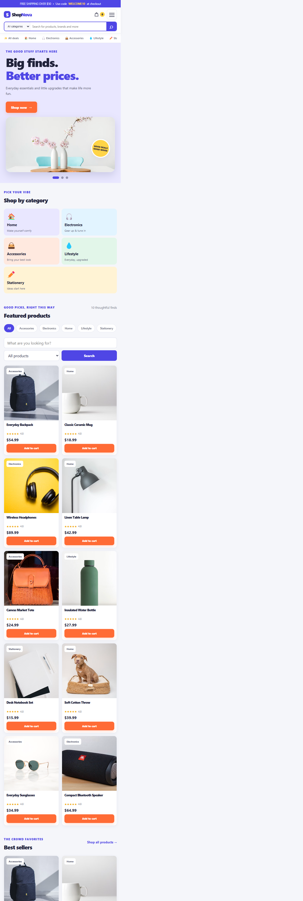
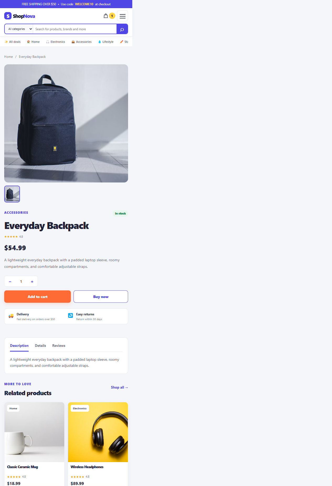
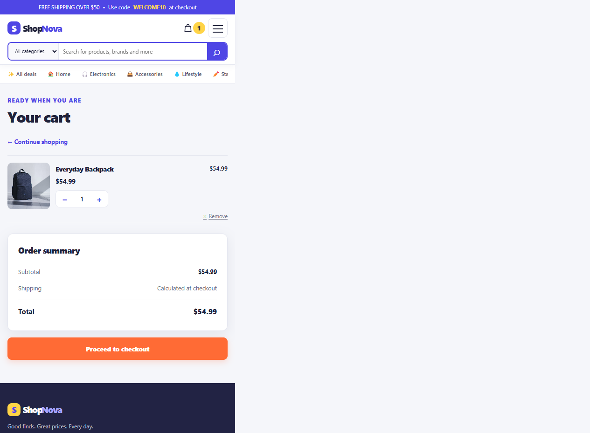
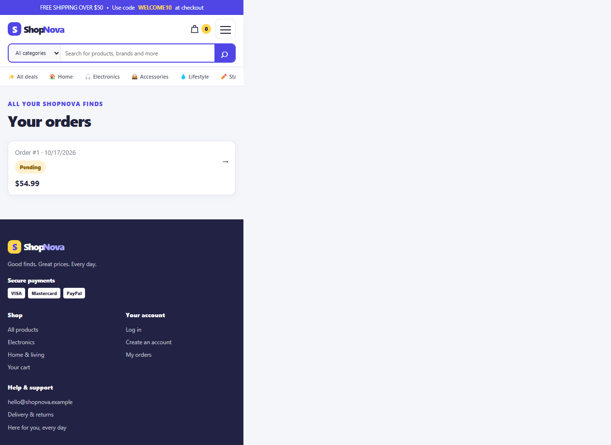

# ShopNova — CodeAlpha E-commerce Store

A responsive, beginner-friendly full-stack ShopNova store built for the CodeAlpha Full Stack Development Internship (Task 1). The frontend uses plain HTML, CSS, and JavaScript. The backend uses Node.js and Express, and SQLite stores accounts, products, carts, and orders.

## Features

- Product grid with search, category filters, stock, and product details.
- Guest shopping cart saved in the browser; signed-in cart saved in SQLite and merged after login.
- Account registration and login using bcrypt password hashes and a JWT in an HTTP-only cookie.
- Protected checkout, server-calculated totals, stock checks, and order history.
- Responsive layout, loading states, inline validation, and friendly error messages.
- Ten sample products added by an idempotent seed script.

## Tech stack

- HTML, CSS, vanilla JavaScript
- Node.js 22.13 or newer (Node 24 LTS recommended; SQLite uses Node's built-in `node:sqlite`)
- Express.js
- SQLite
- bcryptjs and jsonwebtoken

## Folder structure

```text
CodeAlpha_Ecommerce/
├── database/                 # SQLite database is created here (not committed)
├── public/
│   ├── css/styles.css
│   ├── js/
│   │   ├── app.js             # Shared navigation, API and cart helpers
│   │   ├── auth.js
│   │   ├── cart.js
│   │   ├── orders.js
│   │   └── products.js
│   ├── index.html
│   ├── product.html
│   ├── cart.html
│   ├── login.html
│   ├── register.html
│   ├── checkout.html
│   ├── orders.html
│   └── confirmation.html
├── screenshots/               # Storefront screenshots shown below
│   ├── home.png
│   ├── product-details.png
│   ├── cart.png
│   └── orders.png
├── src/
│   ├── db/
│   │   ├── database.js        # Creates SQLite tables and opens the database
│   │   └── seed.js            # Inserts sample products
│   ├── middleware/auth.js
│   ├── routes/
│   │   ├── auth.js
│   │   ├── cart.js
│   │   ├── orders.js
│   │   └── products.js
│   ├── utils/http-error.js
│   └── server.js
├── .env.example
├── .gitignore
├── package.json
└── README.md
```

## Setup and run

1. Install Node.js 22.13+ (Node 24 LTS is recommended).
2. In a terminal, change to the project folder and install packages:

   ```powershell
   npm install
   ```

3. Create your local environment file:

   ```powershell
   Copy-Item .env.example .env
   ```

4. Generate a private JWT signing secret:

   ```powershell
   node -e "console.log(require('crypto').randomBytes(32).toString('hex'))"
   ```

   Copy the output into `.env` as the value of `JWT_SECRET`. Do not share or commit this value. `PORT` can be left blank to use port 3000. `DATABASE_FILE` can be left blank to create `database/store.sqlite`.

5. Add the sample products:

   ```powershell
   npm run seed
   ```

6. Start the app:

   ```powershell
   npm run dev
   ```

   For a regular start without file watching, use `npm start`. Stop either process with **Ctrl+C**.

7. Open [http://localhost:3000](http://localhost:3000).

The SQLite tables are created automatically on the first server or seed run. Running the seed command again will not duplicate the sample products.

## REST API

All API request and response bodies use JSON.

| Method | Endpoint | Description | Access |
|---|---|---|---|
| GET | `/api/health` | Server health check | Public |
| POST | `/api/auth/register` | Create an account and sign in | Public |
| POST | `/api/auth/login` | Sign in | Public |
| POST | `/api/auth/logout` | Clear the sign-in cookie | Public |
| GET | `/api/auth/me` | Get the current account, or `null` | Public |
| GET | `/api/products` | List products; accepts `search` and `category` query parameters | Public |
| GET | `/api/products/categories` | List product categories | Public |
| GET | `/api/products/:id` | Get product details | Public |
| GET | `/api/cart` | Get the signed-in user's cart | Signed in |
| PUT | `/api/cart` | Replace the signed-in user's cart | Signed in |
| POST | `/api/cart/sync` | Merge guest cart into the account cart | Signed in |
| POST | `/api/orders` | Place an order from the account cart | Signed in |
| GET | `/api/orders/my` | List the signed-in user's orders | Signed in |
| GET | `/api/orders/:id` | Get one of the signed-in user's orders | Signed in |

## Security notes

- Passwords are hashed with bcryptjs; plain-text passwords are never stored.
- JWTs are sent only in HTTP-only, SameSite=Lax cookies. HTTPS is required in production so the cookie's `Secure` flag can be enabled with `NODE_ENV=production`.
- All SQL values are parameterized, user input is validated on the server, and API errors use appropriate HTTP status codes.
- Order prices are read from the database, totals use integer cents, stock is checked and reduced in a transaction, and order history is scoped to its owner.
- Keep `.env` and the generated SQLite database out of Git. Use a unique, private `JWT_SECRET` for every deployment.

This is an internship learning project, not a payment service. Checkout records an order but does not process real payments or provide production-grade order fulfillment.

## Screenshots

### Home



### Product details



### Cart



### Orders



## Push to GitHub as `CodeAlpha_EcommerceStore`

This project is already connected to `https://github.com/generalareas9-sys/CodeAlpha_EcommerceStore` and uses the `master` branch. After making changes, push the current branch with:

```powershell
git add .
git commit -m "Update ShopNova storefront"
git push origin master
```

`.gitignore` excludes `.env`, `node_modules/`, generated SQLite files, and other local build output. Check `git status` before pushing to confirm no secrets are staged. GitHub repository description and topics can be managed from the repository’s **About** section.
